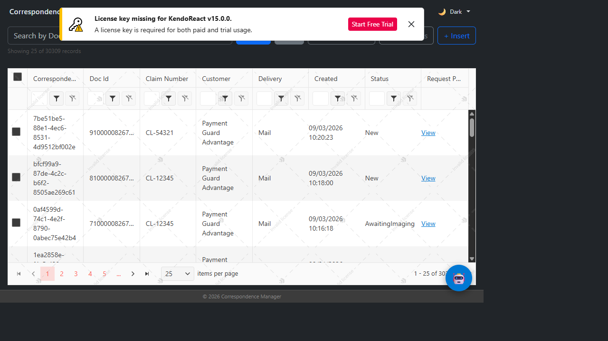
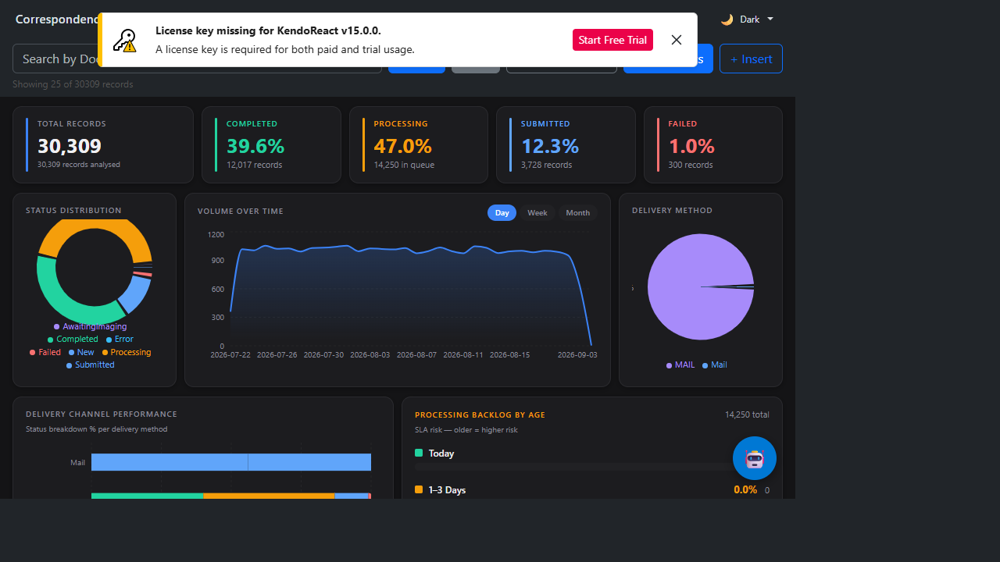
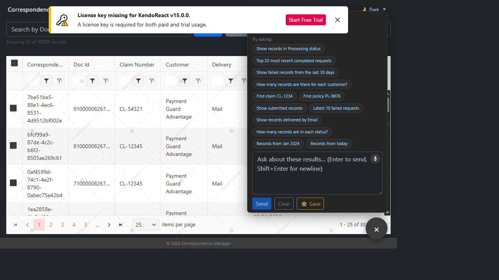

# Correspondence Manager — Demo Talking Points

A one-page cheat sheet for presenting the ECCO Correspondence Manager React app, its AI capabilities, and the business value each feature delivers.

---

## 🎯 Elevator Pitch (30 seconds)

> "This is a modern, AI-augmented front end for managing customer correspondence requests. Instead of clicking through filters and forms, users can search, analyze, send, and export correspondence just by describing what they want in plain English — while still having a full-featured data grid, dashboard, and export toolkit underneath for power users."

---

## 🖼️ Visuals

| Screen | Screenshot |
|---|---|
| **Grid + Search + Toolbar** |  |
| **Analytics Dashboard** |  |
| **AI Assistant Popup** |  |

*(Live demo recommendation: run `npm run dev` and present the running app rather than static images — the AI chat and animated charts are the strongest selling points.)*

---

## 🧩 Tech Stack (for the "how it's built" question)

- **React 19** + **TypeScript** + **Vite** — modern, fast dev/build pipeline
- **Kendo React Grid** — enterprise-grade data grid (sort, filter, resize, reorder, paging)
- **Recharts** — analytics visualizations (pie, bar, area charts)
- **React Bootstrap** — forms, modals, toasts, dropdowns
- **Axios** — API communication with centralized error interception
- **AES-256 client-side decryption** (crypto-js) for encrypted payloads

---

## 🚀 Feature List & Talking Points

### 1. AI-Powered Natural Language Search
**What it does:** Users type things like *"Show failed records from the last 30 days"* or *"Find claim CL-1234"* instead of manually setting filters.
**How it helps:** Zero learning curve for new users; faster than clicking through filter menus; supports fuzzy/contextual queries.
**Demo tip:** Click one of the suggested queries in the AI Assistant popup, or use the 🎤 voice input button to *speak* a search.

### 2. Voice Input (Web Speech API)
**What it does:** Users can dictate their search/query instead of typing.
**How it helps:** Accessibility win; faster for call-center-style workflows where reps are multitasking.

### 3. AI-Powered Payload Generation (Send Correspondence)
**What it does:** Describe a request in plain English — *"Send a welcome kit to John Doe at 123 Main St, Springfield, IL 62701 for claim CL-5432"* — and the AI extracts recipient, address, claim/policy numbers, and delivery method, then pre-fills a structured JSON payload for review.
**How it helps:** Cuts manual data entry dramatically; reduces transcription errors; user still reviews/edits before submitting (human-in-the-loop).
**Demo tip:** Show the "✨ AI-Generated Payload" banner with the extracted-fields summary (📋 Document, 👤 Recipient, 🎫 Claim, 📍 Address, 📮 Delivery).

### 4. Payload Validation & Smart Suggestions
**What it does:** Real-time validation of email, phone, ZIP, claim/policy number formats, and recipient-name placeholders, with one-click "Apply Fix" for common typos (e.g., "gmial.com" → "gmail.com").
**How it helps:** Prevents bad data from ever reaching the backend; guides less experienced users with actionable, plain-English suggestions instead of cryptic validation errors.
**Demo tip:** Type a typo'd email or a placeholder name like "test" into the payload editor and watch the 🔴/🟡/💡 badges update live.

### 5. Smart Error Recovery
**What it does:** Classifies API failures (network, validation, server, unknown), shows a friendly message + suggested fix, and offers a one-click retry with exponential backoff (500ms → 1s → 2s → 4s) for retryable errors.
**How it helps:** Turns a scary stack trace into a clear, actionable message; reduces support tickets; automatic retry recovers from transient network/server hiccups without user effort.

### 6. Intelligent Search Refinement
**What it does:** Detects typos in search terms (*"cliam" → "claim"*), suggests related searches and useful filters (*"Show Failed Requests"*, *"Sort by Date"*), and remembers recent search history — all persisted via localStorage/sessionStorage.
**How it helps:** Helps users find what they need even with imperfect input; learns usage patterns over time; one click to repeat a prior search.

### 7. Analytics Dashboard
**What it does:** KPI cards (Total/Completed/Processing/Submitted/Failed), status distribution donut chart, volume-over-time area chart (day/week/month granularity), delivery-method breakdown, delivery-channel performance, and SLA-risk "processing backlog by age" buckets.
**How it helps:** Gives managers an at-a-glance operational view without needing a separate BI tool; SLA-risk buckets highlight aging requests before they become a compliance problem.

### 8. Full-Featured Data Grid
**What it does:** Server-side and client-side sorting/filtering/paging, resizable & reorderable columns, status-colored rows, select-all (header checkbox) + per-row selection.
**How it helps:** Familiar, Excel-like interaction for power users; large datasets (30K+ records demoed) stay responsive via server-side paging.

### 9. Excel Export (native, no vulnerable dependencies)
**What it does:** Export current page, selected rows, or *all* matching records (parallel-batched fetch) to a color-coded native `.xls` (SpreadsheetML) file — status-colored rows carry over into Excel.
**How it helps:** No SheetJS/xlsx dependency (avoids known high-severity CVEs) while still producing a real Excel file with styling; supports partial or bulk export depending on the user's need.

### 10. Encrypted Payload Viewer
**What it does:** Detects and transparently decrypts AES-encrypted request payloads client-side (with backend-assisted decryption as a fallback), and displays them as formatted JSON or a flattened key/value table.
**How it helps:** Lets support/ops staff inspect the exact payload sent to backend systems without needing raw DB access, while still respecting encryption at rest.

### 11. Multi-Theme UI (6 themes)
**What it does:** Dark (VS Code style), Light, Azure, Meridian, Nord, and Dracula themes — switchable from a header dropdown, persisted to localStorage.
**How it helps:** Personalization/branding flexibility; supports different lighting environments and accessibility preferences; shows the app isn't a one-off internal tool but a polished product.

### 12. AI Query Context Awareness
**What it does:** The AI Assistant is aware of the current grid results, pagination, and pre-computed aggregates — so it can answer analytical questions ("How many records are there for each customer?") without re-querying the backend for every question.
**How it helps:** Fast, cheap follow-up questions; demonstrates a context-aware assistant rather than a generic chatbot bolted on top.

---

## 📋 Quick Feature Checklist (for slides)

- [x] Natural-language search (AI)
- [x] Voice input
- [x] AI payload generation for sending correspondence
- [x] Real-time payload validation with auto-fix suggestions
- [x] Smart error classification + auto-retry
- [x] Typo detection & search refinement + history
- [x] Analytics dashboard (KPIs, charts, SLA risk)
- [x] Enterprise data grid (sort/filter/page/resize/reorder)
- [x] Row selection + select-all header checkbox
- [x] Native Excel export (current page / selected / all — color coded)
- [x] Client-side encrypted payload decryption + JSON/table viewer
- [x] 6-theme UI with persistence
- [x] Context-aware AI assistant (uses live grid + analytics data)

---

## 💡 Suggested Demo Flow (5–7 minutes)

1. **Open the app** → point out the clean grid, theme switcher, and toolbar.
2. **Type an AI search** (e.g., "Show failed records from the last 30 days") → results + status colors update.
3. **Open Analytics** → walk through KPIs, status donut, volume chart, SLA backlog.
4. **Ask a follow-up AI question** ("How many records are in each status?") → show it answers instantly from cached aggregates.
5. **Send a correspondence via AI** ("Send a welcome kit to Jane Doe at 500 Elm St, Austin TX 78701 for claim CL-9001") → show the AI-generated payload + validation badges.
6. **Trigger a validation error** (typo an email) → show the Apply Fix suggestion.
7. **Export** current page / selected rows to Excel → open the file to show color-coded status rows.
8. **Switch theme** (Dark → Nord or Dracula) → shows polish/personalization.
9. *(Optional)* Disconnect network briefly to show Smart Error Recovery's retry UI.

---

## ⚠️ Known Demo Caveat
The Kendo React Grid license key isn't configured in this environment, so a "License key missing" banner appears at the top. This is a licensing/trial notice only — it doesn't affect functionality. Dismiss it (✕) before presenting, or mention it's a placeholder license for the demo environment.
